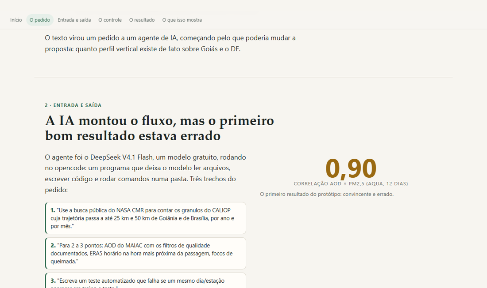

# Do formulário à base integrada — AOD, perfil vertical e PM2,5

**Quanto perfil vertical (CALIOP) e PM2,5 público existem em Goiás e no DF, e um protótipo que integra MAIAC, ERA5 e FIRMS com controles.**

Encontro individual do Estágio Docência · LAPIG/UFG · 06/11/2026.

- **Ver a página:** <https://victorgit10.github.io/jackeline-pm25/>
- **Repositório:** <https://github.com/VictorGit10/jackeline-pm25>



## O que tem aqui

- **`index.html`**: a página do encontro. Começa pela resposta ao formulário e mostra o que a IA generativa fez com ela: a entrada, a primeira saída, os controles, o resultado e o que isso mostra. Funciona offline (imagens embutidas).
- **O pacote** (`codigo/`, `dados/`, `figuras/`, `RELATORIO.md`, `REFERENCIAS.md`): o trabalho completo, executado de ponta a ponta. Todos os números saem dos scripts. Instruções abaixo.
- **`CLAUDE.md` e `AGENTS.md`**: o contexto para a IA que for continuar o trabalho.
- **`docs/revisoes/`**: o caminho do trabalho, para quem quiser auditar: o formulário (`CONTEXTO.md`), o pedido dado ao agente (`PEDIDO.md`, `REGRAS-COMUNS.md`), as correções pedidas (`CORRECOES*.md`) e a conferência independente de outro modelo (`CONFERENCIA-MINIMAX.md`).

## Como foi feito

1. O formulário virou um pedido escrito para um agente de IA (DeepSeek V4.1 Flash, no opencode), com regras: dados públicos, todo número saindo de script, controle em cada conclusão, referência só com DOI conferido.
2. O agente executou tudo. Claude conferiu (testes, números, DOIs) e pediu correções.
3. Outros modelos revisaram sem poder alterar nada (MiniMax M3.1 e Gemini Argon). Cada afirmação deles foi conferida no código antes de corrigir.
4. A página foi redigida pelo Gemini 3.8 a partir de um briefing com os fatos conferidos, e revisada.

Os arquivos brutos maiores (mosaicos, ZIPs baixados) não estão no repositório: os scripts baixam de novo. O projeto do Earth Engine aparece como `SEU-PROJETO-EARTH-ENGINE`: troque pelo seu.

## Continuar com uma IA

O repositório foi organizado para um assistente ler. Cole o link no Claude, ChatGPT, Gemini ou Codex e peça, por exemplo: "Explique a estrutura deste repositório e como rodar o pacote", ou "Adapte o procedimento para os meus dados". O `CLAUDE.md` traz o contexto, as armadilhas e a ordem dos scripts.

## Licença

Texto, página e figuras: CC BY 4.0. Código em `codigo/`: MIT. Detalhes em `LICENSE`.

---

# O pacote

## AOD × PM2,5 em Goiás e no DF: quanto perfil vertical existe e um protótipo que roda

Este pacote responde a duas perguntas práticas antes de investir meses na tese:

1. **Existe perfil vertical de aerossol (CALIOP) suficiente sobre Goiânia e Brasília?**
2. **Dá para montar, com dado aberto, a tabela AOD × meteorologia × queimadas × PM2,5
   e testar o ajuste vertical mais simples (AOD dividido pela altura da camada limite)?**

A resposta curta: sim para a tabela, com uma ressalva grande — **o CALIOP só serve como
climatologia e estudo de caso, não como dado diário**, e em Brasília as passagens noturnas
na estação de queimadas são raríssimas. Os detalhes com números estão em `RELATORIO.md`.

## O que tem aqui

```
codigo/                  scripts, na ordem de execução
dados/                   saídas (CSV, JSON) e os ZIPs brutos do MonitorAr
figuras/                 as quatro figuras do relatório
RELATORIO.md             resultados, limites, o que não deu para fazer
REFERENCIAS.md           16 referências com DOI conferido no Crossref (6 no Brasil)
CLAUDE.md                contexto para a IA que for continuar o trabalho
```

## Como rodar

Precisa de Python 3.10+ com `pandas`, `numpy`, `matplotlib`, `scikit-learn`,
`requests` e `earthengine-api`. O Earth Engine precisa estar autenticado na máquina
(`ee.Initialize(project='SEU-PROJETO-EARTH-ENGINE')`).

```bash
python codigo/01_calipso_cmr.py     # passagens do CALIOP (API pública do CMR, sem login)
python codigo/02_estacoes_pm25.py   # estações de PM2,5 GO/DF e portas de acesso
python codigo/03_prototipo_gee.py   # tabela integrada no ponto Fercal + figura
python codigo/04_validacao.py       # desenho de validação e teste de dependência
python codigo/teste_validacao.py    # testes automáticos do desenho (5 testes)
python codigo/05_leitor_calipso.py  # leitor HDF4 do CALIOP (autoteste)
python codigo/06_referencias.py     # confere os DOIs e gera REFERENCIAS.md
python codigo/07_selecao_variaveis.py  # seleção de variáveis sem vazamento
python codigo/08_checagens.py       # números de rastreabilidade (QA, pixels, horários)
```

Ou tudo de uma vez: `python codigo/rodar_tudo.py` (uns 12 minutos na primeira vez; o 02 baixa
~90 MB de ZIPs e o 03 consulta o Earth Engine em 60 recortes).

## O que você leva para a tese

| Arquivo | Para que serve |
|---|---|
| `dados/calipso_passagens_por_ano.csv` | passagens a ≤5/25/50 km por ano, separadas em dia e noite |
| `dados/calipso_passagens_por_mes.csv` | o mesmo por mês (sazonalidade das queimadas) |
| `dados/calipso_passagens_eventos.csv` | a lista das passagens (data, distância, dia/noite) para cruzar com outras fontes |
| `dados/prototipo_integrado.csv` | tabela ponto × dia × **satélite** no ponto Fercal: AOD, BLH, vento, umidade, temperatura, CAPE/CIN, fogo, PM2,5 horário e diário |
| `dados/prototipo_integrado_diario.csv` | o mesmo, agregado em ponto × dia × satélite |
| `dados/selecao_variaveis_modelos.csv` | comparação dos conjuntos de variáveis e do baseline, com validação por semanas |
| `dados/checagens.json` | custo da máscara de QA, pixels válidos, horários, controle de QA, dias comuns |
| `dados/pm25_estacoes_monitorar_go_df.csv` | estações com PM2,5 em GO/DF no MonitorAr e o período de cada uma |
| `dados/pm25_fontes.csv` | cada fonte de PM2,5, o que oferece e como se acessa |
| `dados/validacao_resultados.csv` | quanto o R² muda conforme o desenho de validação |
| `figuras/*.png` | as cinco figuras usadas no relatório |

## Quatro decisões que são suas, não do script

1. **Raio de associação.** O protótipo usa 10 km para o AOD. Em queimadas, a pluma tem
   gradiente forte; testar 5, 10 e 25 km é uma decisão metodológica, e o script aceita
   trocar `RAIO_AOD_M`.
2. **Qual satélite usar.** Terra e Aqua foram mantidos separados de propósito: no Fercal, a
   passagem de Terra vai de 08:00 a 10:40 (média 09:21) e a de Aqua de 13:25 a 16:30 (média
   14:57), com camadas limite médias de 827 m e 2.028 m. Escolher um como principal — e o
   outro como verificação — é decisão metodológica. O script já guarda os dois.
3. **Como representar a vertical.** Dividir por BLH é o mais simples; o passo seguinte,
   que o CALIOP permite, é a **fração do AOD dentro da camada limite** (`fracao_abl`,
   calculada no leitor do script 05). Comparar os dois é o núcleo da sua pergunta.
4. **Papel do CATT-BRAMS.** Se ele entrar como preditor, o modelo pode estar copiando a
   simulação. O script 04 mostra o teste: sem e com a variável, mais a importância dela,
   mais a correlação dos resíduos.

## Baixar o CALIOP (é o único passo que exige a sua conta)

O leitor está pronto, mas os arquivos `.hdf` ficaram de fora porque exigem Earthdata Login.

1. Crie/reuse a conta em `https://urs.earthdata.nasa.gov` e aceite a aplicação "NASA
   GES DISC"/"ASDC" em *Applications*.
2. Opção A (recomendada): `pip install earthaccess pyhdf`, depois
   `python -c "import earthaccess; earthaccess.login()"` e
   `earthaccess.search_data(short_name='CAL_LID_L2_05kmAPro', version='V5-00',
   bounding_box=(-50.3,-17.8,-48.0,-15.5), temporal=('2023-06-01','2023-06-30'))`.
   Opção B: baixar à mão em `https://search.earthdata.nasa.gov`.
3. Rode `python codigo/05_leitor_calipso.py caminho/do/arquivo.hdf` — ele calcula o AOD
   total, o AOD abaixo da camada limite e a fração (`fracao_abl`) por perfil a ≤25 km.

Comece por **junho de 2023** (últimos dados que existem) e por **agosto–outubro de 2015**
(ano com muitas passagens noturnas em Goiânia).

## Limites deste pacote (leia antes de citar os números)

- O protótipo cobre **19/09/2024 a 31/12/2025** num único ponto (Fercal), com **166 pares
  dia-satélite** de AOD e PM2,5 horário. É demonstração de mecânica, não resultado
  científico: nenhum modelo supera a média do treino na validação por semanas.
- **Goiás não tem série pública de PM2,5** no MonitorAr. As estações do DF só entram em
  2024. Sem isso, não há como calibrar nada em Goiânia com dado aberto.
- O CALIOP **não foi baixado**: exige conta Earthdata. O leitor está pronto e testado com
  dados sintéticos (`python codigo/05_leitor_calipso.py`).
- A máscara de QA do MAIAC descarta **67%** dos registros na série longa; o piso de
  **20 pixels** (de ~314 no disco de 10 km) é o mínimo adotado, e a sensibilidade está no
  relatório.
- Os arquivos do MonitorAr em `dados/*.zip` são dados brutos (92 MB). Podem ser apagados;
  o script 02 baixa de novo.

